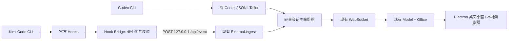

# Codex + Kimi Code 实时像素办公室：可实施 MVP 技术方案

**调研日期：**2026-11-08  
**唯一主底座：**[rezored/cubicle-crew](https://github.com/rezored/cubicle-crew)  
**审核版本：**Cubicle Crew v2.22.0，提交 `6e71e32b66952cbf46e8b7db1d84d1415337cc46`  
**目标环境：**Windows 11 x64；Omarchy/Arch Linux x86_64（Hyprland/Wayland）。  
**范围约束：**纯本地、旁路观察；不启动/操纵 Agent，不使用额外 LLM，不重构像素渲染器，不引入数据库/微服务。

> 证据等级：`[源码已确认]` = 通过 GitHub 读取对应源码；`[官方文档确认]` = 官方 API/说明；`[设计建议]` = 本方案尚未实现；`[实机待验证]` = 未在用户机器上运行。仓库存在相关代码，不等于实机兼容已经通过。

## 1. 执行摘要

**选定 Cubicle Crew，采用现有 Codex JSONL Provider + 新增 Kimi Code Hook Bridge + 最小生命周期修复。** Cubicle Crew 已具备 Electron 桌面窗口、像素角色、状态动作、WebSocket、Codex JSONL 增量监听、第三方 Agent 本地 HTTP 接口。实际缺口是：Codex 未完整处理回合完成/中断，Kimi 新 Hook 的 `tool_call_id`、`TurnStarted`、`PermissionResult`、`StopFailure`、心跳未覆盖；现有 8 秒闲置判定会误判长思考。

不改变渲染技术栈：工程本身为 JavaScript ES Modules + Node/Electron；首版不引入 TypeScript 构建链。界面 `coding` 复用原生 `typing` 动作，`testing` 复用 `running` + 测试标识，`success` / `error` 用短暂特效；不重画人物。

交付门槛：**已运行的两种 CLI 真实事件可在 1–2 秒目标内反映；并发不同角色不串台；长思考不凭时间自动认定结束；等待可识别时显式表示；本地隐私默认最小化；Windows/Omarchy 均可运行。** P95 ≤2 s 为目标而非调研已经测得的结果，必须在真实平台记录。

## 2. 源码审查

| 仓库 | 检查版本 | 技术与许可证 | 结论 |
|---|---|---|---|
| [Cubicle Crew](https://github.com/rezored/cubicle-crew) | v2.22.0, 2026-11-07 | Node ESM, Electron, ws, MIT | 一键办公桌面应用，最小补丁即可达成目标 |
| [AgentMove](https://github.com/FoothillSolutions/agent-move) | v1.0.12, 2026-04-04 | TS/Fastify/Chokidar/PixiJS, `package.json` 声明 MIT | Codex watcher 成熟，但 Kimi Hook 需嵌入其 Claude Hook 管理器；浏览器优先 |
| [Pixel Agents](https://github.com/pixel-agents-hq/pixel-agents) | v1.5.0, 2026-10-16 | TS/VS Code/React, MIT | 引擎和测试设计丰富，独立小组件需要较多工作 |
| [Pixel Office 社区 Fork](https://github.com/josephndex/pixel-office) | 2026-08-10 | Pixel Agents 衍生 | 已加 `codexTailer.ts`，仅参考其会话事件，不作为底座 |

Cubicle Crew 已检查源码路径：
- [`providers.js`](https://github.com/rezored/cubicle-crew/blob/6e71e32b66952cbf46e8b7db1d84d1415337cc46/providers.js)：`CODEX_HOME`、`CODEX_ROOT`、`codexLine`；读取 `session_meta`/`response_item`/`event_msg`，工具调用及对应输出。
- [`server.js`](https://github.com/rezored/cubicle-crew/blob/6e71e32b66952cbf46e8b7db1d84d1415337cc46/server.js)：`POLL_MS=400`、`SCAN_MS=2000`、偏移量增量读取、WebSocket、`/api/event`、`scanSessions()`。其 `scanSessions()` 主要直接汇集 Claude 运行中的 PID 会话、External、OpenCode、Antigravity，Codex 缺少同等 live registry。
- [`external.js`](https://github.com/rezored/cubicle-crew/blob/6e71e32b66952cbf46e8b7db1d84d1415337cc46/external.js)：`fromNative` 和 `fromHook`，外部会话状态管理；原生 `tool_start`/`tool_end`、`waiting`、`idle`、`end`；需要 Kimi 兼容增强。
- [`docs/api.md`](https://github.com/rezored/cubicle-crew/blob/6e71e32b66952cbf46e8b7db1d84d1415337cc46/docs/api.md)：`POST http://127.0.0.1:4317/api/event`，动态端口可能转为 4318–4320；原生或 Hook 格式可接入。
- [`public/rules.js`](https://github.com/rezored/cubicle-crew/blob/6e71e32b66952cbf46e8b7db1d84d1415337cc46/public/rules.js)：工具映射 `Write/Edit→typing`、`Read/Grep/Glob→reading`、`Bash→running`、`AskUserQuestion→waiting`。
- [`public/model.js`](https://github.com/rezored/cubicle-crew/blob/6e71e32b66952cbf46e8b7db1d84d1415337cc46/public/model.js)：按活跃工具、busy、waiting 算动作，未明确 busy 时 8 秒 idle；已有 `celebrate`，但主要基于工作时长触发。
- [`public/characters.js`](https://github.com/rezored/cubicle-crew/blob/6e71e32b66952cbf46e8b7db1d84d1415337cc46/public/characters.js)、[`public/office.js`](https://github.com/rezored/cubicle-crew/blob/6e71e32b66952cbf46e8b7db1d84d1415337cc46/public/office.js)、[`public/particles.js`](https://github.com/rezored/cubicle-crew/blob/6e71e32b66952cbf46e8b7db1d84d1415337cc46/public/particles.js)：已有姿态与粒子特效，无需重建。
- [`electron/main.js`](https://github.com/rezored/cubicle-crew/blob/6e71e32b66952cbf46e8b7db1d84d1415337cc46/electron/main.js)、[`package.json`](https://github.com/rezored/cubicle-crew/blob/6e71e32b66952cbf46e8b7db1d84d1415337cc46/package.json)：独立 Electron、托盘、小窗、NSIS、AppImage；Linux 明确不支持应用内启动项设置及透明背景切换。
- [`LICENSE`](https://github.com/rezored/cubicle-crew/blob/6e71e32b66952cbf46e8b7db1d84d1415337cc46/LICENSE)：MIT，保留原版权与协议全文。

## 3. 候选对比与选型结论

按「现有桌面组件」「已有 Codex 被动监测」「Kimi 最短接入」「上游维护冲突」「跨平台」五项考量，Cubicle Crew 的总改动最少。AgentMove 的 [`codex-watcher.ts`](https://github.com/FoothillSolutions/agent-move/blob/85d377110721d8dd4e0c68a23fb8c0108e611538/packages/server/src/watcher/codex/codex-watcher.ts) 采用 Windows Chokidar 500ms 轮询可供对照；[`hook-event-manager.ts`](https://github.com/FoothillSolutions/agent-move/blob/85d377110721d8dd4e0c68a23fb8c0108e611538/packages/server/src/hooks/hook-event-manager.ts) 存在权限请求保持连接的设计，不适合移植为只观察的 Kimi Hook。Pixel Agents 和社区 Fork 可参考测试与 Codex Tailer，但不混合技术栈。

## 4. 现状与缺口

**Codex：** `$CODEX_HOME/sessions/YYYY/MM/DD/rollout-*.jsonl`，默认 `~/.codex`；已有 function_call/output 与工具映射。[OpenAI Codex 协议源码](https://github.com/openai/codex/blob/748ab55ca7de0b647d9a7a9d9a8e70e00f28666d/codex-rs/protocol/src/protocol.rs) 明确 `task_started`/`turn_started`、`task_complete`/`turn_complete`、`turn_aborted`，其中 TurnComplete 可带 `error`；现有 `codexLine` 未处理它们。须注意协议事件存在不保证每个安装版本的 JSONL 都持久化所有字段，因此需要真实 CLI fixture 核实。Codex 完成一轮不意味着 CLI 进程退出；文件修改时间也不等于进程确实在运行。未经直接观测，不承诺 100% 识别审批等待。

**Kimi：**新版 [Kimi Code CLI 官方文档](https://www.kimi.com/code/docs/kimi-code-cli/customization/hooks.html)，不是已归档旧版 `kimi-cli`。截至 2026-11-08 官方变更记录最新是 **2.5.2 (2026-11-06)**；配置 `~/.kimi-code/config.toml`（可由 `KIMI_CODE_HOME` 覆盖）。`[[hooks]]` 只允许 `event`、`matcher`、`command`、`timeout`，Hook JSON 经 stdin 传入，`hook_event_name`、`session_id`、`cwd` 及其他 snake_case 字段。源码 `packages/agent-core-v2/src/features/externalHooks/internal/types.ts` 已列出：`SessionStart`、`TurnStarted`、`PreToolUse`、`PostToolUse`、`PostToolUseFailure`、`PermissionRequest`、`PermissionResult`、`Stop`、`StopFailure`、`Interrupt`、`SessionEnd`、`SessionHeartbeat` 等。新的工具调用关联字段为 `tool_call_id`（需要在实际 CLI payload 测试验证）；现有 Cubicle Crew `external.js` 仅提取 `tool_use_id` / `toolUseId`，并把 `PostToolUseFailure` 当作普通结束，需修改。`SessionHeartbeat` 每 60 秒一次，**只能表示存活，不能证明回合正在运行**。

Kimi `Stop` 属于可阻断 Hook，严格而言是「准备完成」，若其他 Hook 拦截，可能继续执行；不要把每次 `Stop` 永远当成高置信度完成事实。Kimi Tool `PostToolUseFailure` 仅说明单个工具失败，不等于整个任务失败。旧版 Kimi 配置目录、旧版 Hook 语法不能借用。**Kimi 自动检测的前提是提前安装了观察型 Hook**；已经开始但还未触发任何新事件的旧会话不能被凭空识别。启用 `SessionHeartbeat` 后，正在运行的会话可在下一次 60s 心跳被重新发现，但这一心跳并不能恢复当前具体动作。

**Codex 其他运行方式的兼容性：**官方 [Codex App Server](https://learn.chatgpt.com/docs/app-server) 支持 `codex app-server`、订阅 turn/item 事件以及用 `codex --remote` 连接它；这是为**使用该 App Server 的客户端**提供实时事件，不等于可以附着到任意已经运行的普通 Codex TUI。官方 [Codex SDK](https://github.com/openai/codex/blob/main/sdk/typescript/README.md) 以启动或恢复 Codex 工作线程为目标，不符合本 MVP 的纯旁路需求。因此 P0 仅对写入本地相同会话目录的 CLI/相关运行环境实行 JSONL 被动监视；若 IDE/GUI 复用了该目录，可尝试识别，但须逐一实机核实。App Server/SDK 集成可在明确需要主动运行或共享 App Server 时另立 P1，不影响主底座选型。

## 5. MVP 系统架构



无需新常驻服务；Hook Bridge 为短生命周期 Node 子进程，读取 stdin、过滤字段后短超时 POST，任何错误均静默退出 0，无 stdout/stderr，不影响 CLI 权限决策。Cubicle Crew Electron 主进程继续承载原 HTTP 服务和 WebSocket。所有监听默认 `127.0.0.1`；关闭现有可选 LAN 分享和非必要外部联网功能。

因原服务器可能退让至 4318–4320，启动成功后原子写 `~/.pixel-office/bridge.json`（`host=127.0.0.1`,`port`,`pid`,`started_at`），Hook 读取该文件并检验本地服务可用，过期/不存在即静默跳过，不向未经确认的端口泄露事件。

**事件结构**（内部概念，不改造整个上游 WebSocket 协议）：

```json
{
  "provider": "kimi",
  "session_id": "session-abc",
  "turn_id": "7",
  "event_type": "tool_started",
  "tool_call_id": "call-001",
  "tool_name": "Bash",
  "timestamp": "2026-11-08T16:00:00Z",
  "project": "my-project",
  "normalized_state": "testing",
  "event_source": "kimi_hook",
  "state_confidence": "inferred"
}
```

**观察 ≠ 推断：** `PreToolUse` 是 observed；`Bash` 判断为 `testing` 依赖命令名规则，属于 inferred；无可用数据状态标注 unknown。内部可暂存真实绝对路径用于映射会话，传输到 UI 默认仅显示目录 basename；不保留命令内容、模型回复、文件内容、token 或环境变量。

## 6. Provider 适配与状态机

| 规范状态 | 动画实现 | 证据 |
|---|---|---|
| idle | 原 `idle`（咖啡/散步） | `turn_complete` / `Stop` 后、尚无活跃回合 |
| thinking | 原 `thinking` | 回合开始且无正在执行的工具；**不能因 8 秒无日志直接降级** |
| reading | 原 `reading` | `Read`、`Grep`、`Glob`、`WebFetch` 等工具启动 |
| coding | 原 `typing` | `Write` / `Edit` / `apply_patch`，仅表示编辑行为 |
| running | 原 `running` | `Bash` / shell 工具启动 |
| testing | 原 `running` + 测试图标/气泡 | 本地识别 `npm test`、`pnpm test`、`pytest`、`cargo test`、`go test`、`vitest`、`jest` 等；heuristic |
| waiting | 原 `waiting` | 明确 `PermissionRequest` / 问题请求；无证据不猜测 |
| success | 原庆祝特效，持续 1.2–2 s | Codex 带无错结果的 turn complete；Kimi `Stop` 标注低一档置信度 |
| error | 原红色提示或粒子反馈，持续 1.2–2 s | 回合失败、工具失败可区别表现；取消不自动判失败 |

`delegating` 为原项目自带状态，保留不新增设计；Kimi subagent 事件在 P0 中可表现为主角色委托，P1 才扩展独立子角色和精确关联。

**Kimi Hook 映射：**

| Hook | 内部动作 | 注意 |
|---|---|---|
| `SessionStart` | `presence` / `start` | 创建角色，不能直接认为回合 busy |
| `TurnStarted` | `turn_start` | busy、无 activeTool 时 thinking；用 `turn_id` 去重 |
| `PreToolUse` | `tool_start` | 使用 `tool_call_id` 精确关联；局部判断测试 |
| `PostToolUse` | `tool_end` | 仅关闭对应工具；回合继续 thinking |
| `PostToolUseFailure` | `tool_end` + `tool_failure` 特效 | 不直接结束整轮 |
| `PermissionRequest` | `waiting` | 等待用户，不允许本软件批准/拒绝 |
| `PermissionResult` | `permission_resolved` | 解除等待；按当前活跃回合/工具返回原状态 |
| `Stop` | `turn_complete` | 延迟短暂确认；当作预期结束，其他 Hook 可阻断它 |
| `StopFailure` | `turn_failed` | 错误特效后 idle |
| `Interrupt` | `turn_interrupted` | 无庆祝；不一定属于错误 |
| `SessionEnd` | `end` | 清理角色；退出时避免闪烁 |
| `SessionHeartbeat` | `heartbeat` | 仅 lastSeen；绝不能把 idle 强行变 busy |

**Codex JSONL 映射：** `event_msg.payload.type in ['task_started','turn_started']` → `turn_start`；`task_complete`/`turn_complete`→ 检查 `payload.error` 的 `turn_complete`/`turn_failed`；`turn_aborted`→ `turn_interrupted` 或带错误的 `turn_failed`；`response_item.function_call` → `tool_start`；相同 `call_id` 的 output → `tool_end`；`reasoning`/assistant message → thinking 过程信号，不代表完成。测试实际 rollout 结构后再定最终解析白名单。

**状态归并规则：** 单个 session 独立存储 `activeTurn`, `activeToolIds`, `waiting`, `lastSeen`, `lastActivity`, `lastOutcome`；优先级 `waiting > 当前 activeTool > thinking(activeTurn) > idle`，`success/error` 为不改变会话存活的瞬时效果。Kimi 和 Codex 的 agent key 统一 `provider + ':' + hash(raw_session_id)`，防止跨项目/跨 Provider 串台，不将原始会话 ID 直接显示。

**异常和重启：**
1. 重复事件按 `(provider, session, event_type, turn_id/tool_call_id)` 在短 TTL 内去重；同一调用完成后记录 tombstone，迟到的 start 不得重新打开已结束的工具。
2. Hooks 并发导致乱序时按 `tool_call_id` 配对；如果调用 ID 缺失，只在唯一候选工具匹配时安全结束，否则维持 `unknown`/超时清理，严禁随意 pop 最后一个工具。
3. 工具动画最短保持约 350–500 ms，抑制工具切换抖动；但 waiting / error 立即覆盖。具体阈值通过真实事件延迟测量调整。
4. 未收到事件的长思考：只要 `activeTurn=true` 且会话有充分存活证据，不套用原来的 8 秒 idle；若长时间无进一步证据则显式标为 `uncertain` / 最近活动，而非假定闲置或完成。
5. Kimi 被强制杀死可能没有 `SessionEnd`；3 个心跳周期未出现时标记 stale，后续有限时间清除。不要把 60s heartbeat 当作动画响应 1–2s 的来源。
6. Codex 在启动时扫描最近修改会话的末尾（上限例如 128–256 KiB/文件），只恢复已证实的最新回合状态，不重放历史全部工具动画；恢复的信息标注 `restored`，若不能确定仍存活则展示 idle/unknown。
7. Kimi 在监控器重启后通过随后 Hook/最多下一次 60s heartbeat 恢复角色；只有心跳没有当前回合证据时展示在线但未知，不假装 thinking。P0 不承诺中断期间每一秒的状态都能精确补回；如需此能力，P1 可做最小本地事件缓存。

## 7. 代码改造清单与伪代码

目标是不新增通用 Agent Framework；仅对已有模块做局部补丁。

### 7.1 新增文件

| 文件（建议路径，创建前按当前工程风格校准） | 责任 | 依赖 |
|---|---|---|
| `kimi/hook-bridge.mjs` | **可独立复制的单文件桥接脚本**；读 stdin、过滤敏感数据、转换为 External 原生事件、发现本机端口、HTTP POST、静默退出 | Node 标准库；开发和打包均可用 |
| `kimi/hooks-cli.mjs` | `install/status/uninstall`，幂等编辑 `config.toml`，严格保留非本工具配置、备份和原子写入 | `KIMI_CODE_HOME`，可选轻量 TOML 语法验证 |
| `kimi/normalize.mjs` | 如 Bridge 保持纯单文件，可仅供测试复用；否则必须随 Bridge 一起复制到打包资源目录 | 无敏感日志 |
| `bridge-runtime.js` | 原应用写入/删除 `~/.pixel-office/bridge.json`；提供端口、实例标识 | `server.js`、`electron/main.js` |
| `test/kimi-events.test.js` | 使用脱敏 fixtures 验证 Kimi 映射、乱序、失败/审批/心跳 | Node 内置 test |
| `test/codex-lifecycle.test.js` | Codex 两种事件别名、成功/错误、中断、JSONL 半行、重启恢复 | Node 内置 test |
| `test/kimi-installer.test.js` | TOML 幂等安装、无损卸载、路径带空格、其他 hooks 无变化 | 临时目录 |
| `test/bridge-transport.test.js` | 断开服务、动态端口、无 stdout、隐私字段过滤、时延 | 临时本地 HTTP 服务 |
| `docs/kimi.md` / `docs/omarchy.md` | 安装、验证、卸载、问题排查、已知边界 | — |

如希望更少文件，可以将 `normalize.mjs` 逻辑合并到单文件 `hook-bridge.mjs`，但不应将事件解析硬编码到整个 `server.js`。

### 7.2 修改文件

| 现有文件 | 修改边界 | 禁止事项 |
|---|---|---|
| `providers.js` | 扩充 `codexLine` 的 turn 事件；保留工具解析和用量函数 | 不重写 Codex 轮询 |
| `server.js` | 将 Codex live 列表合入 `scanSessions()`；处理 turn 生命周期；写 runtime port file；只广播最小安全字段 | 不改变 HTTP/WS 大框架 |
| `external.js` | 原生事件枚举加 `turn_start/turn_complete/turn_failed/tool_failure/permission_resolved/heartbeat/turn_interrupted`；`activeTurn`/`activeToolIds`；去重；heartbeat 不重置 busy | 不把 Kimi 等同 Claude 完整 Hook payload |
| `public/model.js` | 优先保持 active turn、支持 `outcome` 单次效果、避免 8 秒误判；状态稳态抖动控制 | 不改角色渲染引擎 |
| `public/main.js` | 监听 outcome 事件，调用已有庆祝或简单失败特效 | 不引入 PixiJS/React |
| `public/config.js` | 增加 Kimi provider 显示名称/标识 | 不动全部 UI 配色 |
| `public/rules.js` | 补齐工具名映射和测试标识（若有必要） | 不把任意未知工具判为“正在写代码” |
| `electron/main.js` | 如打包：将 Bridge 从 asar 复制到用户可执行的位置；增加托盘/设置入口「Enable/Disable Kimi integration」（调用同一安装器函数）；确保主服务器启动后写 port | 不让普通 Node 直接加载 `.asar` 内脚本 |
| `package.json` | `kimi:hooks:install`、`kimi:hooks:uninstall`、`kimi:hooks:status`，按需覆盖打包资源 | 不重构 package manager |

### 7.3 Kimi Bridge 伪代码

注意：原项目 `external.ingest` 的检测逻辑为：请求体若带 `session_id`，会自动当作原始 Hook 解析。因此 **Bridge 发送的是 External 的 native schema，必须使用 `agent` 和 `type`，不要原样透传带 `session_id` 的对象**。

```js
// kimi/hook-bridge.mjs —— 伪代码，非完整实现
async function main() {
  try {
    const raw = JSON.parse(await readStdinWithLimit(1024 * 1024));
    if (!isAllowedKimiEvent(raw.hook_event_name) || !raw.session_id) return;

    const agent = stableHash(raw.session_id); // provider 由 External 添加 kimi: 前缀
    const minimal = toNativeEvent({
      type: raw.hook_event_name,
      agent,
      provider: 'kimi',
      tool: normalizeTool(raw.tool_name),
      id: raw.tool_call_id ?? raw.tool_use_id ?? null,
      turnId: raw.turn_id ?? null,
      label: safeProjectBasename(raw.cwd),
      isTest: safeTestCommandPredicate(raw.tool_input?.command),
    });
    // 禁止传递 raw.prompt, tool_input, tool_output, error_message, cwd 绝对路径等
    const endpoint = await findLoopbackEndpointFromRuntimeFile();
    if (!endpoint) return;
    await fetch(endpoint + '/api/event?from=kimi', {
      method: 'POST',
      headers: { 'Content-Type': 'application/json' },
      body: JSON.stringify(minimal),
      signal: AbortSignal.timeout(250),
    });
  } catch { /* fail-open: 不输出、不抛异常 */ }
}
await main();
// 程序自然退出 0；stdout/stderr 始终为空，禁止输出影响 Agent 上下文
```

上面 `toNativeEvent()` 转成 `{agent,provider,type,tool,id,label,detail?}`；`type` 必须由 `external.js` 白名单扩充支持。`tool_call_id` / `call_id` 规范化必须**可重复确定**；同一次调用的开始与结束得到同一个 ID。特殊字符可稳定 hash，而不能随意截断造成碰撞。

Kimi 当前源码工具事件使用 `toolCallId`，钩子文档声明 JSON 字段使用 snake_case；首次实机验收必须检查 `tool_call_id` 确实存在，否则依据真实 payload 修订映射。所有调试日志只能输出“某一事件到达、类型、耗时、状态”，不能打印原 Hook JSON。

**Hook 本身有可能同步阻断 Agent。**官方 `PreToolUse`/`Stop`/`UserPromptSubmit` 可阻断，Hook 超时/出错为 fail-open，但仍会造成短延迟或 CLI 警告。设置 `timeout = 1` 秒、HTTP 预算 250 ms、静默退出 0、无 stdout/stderr，不做权限决策。一次新 Node 启动与 stdin 解析仍有非零开销；在慢机器上评估是否将 timeout 调至 2 秒、HTTP 预算设为 100–200 ms（不是为了等云端服务）。

### 7.4 Kimi Hook 安装器

P0 建议配置 12 个事件：

`SessionStart`、`TurnStarted`、`PreToolUse`、`PostToolUse`、`PostToolUseFailure`、`PermissionRequest`、`PermissionResult`、`Stop`、`StopFailure`、`Interrupt`、`SessionEnd`、`SessionHeartbeat`。

每个事件一条 `[[hooks]]`；完整命令和路径由安装器按平台**生成**，不是要求用户手填。生成后的每条格式如下：

```toml
# BEGIN pixel-office-kimi managed hooks
[[hooks]]
event = "PreToolUse"
command = "node /absolute/path/to/hook-bridge.mjs"
timeout = 1
# END pixel-office-kimi managed hooks
```

这是 Linux 格式示意；Windows 必须正确引用 `node.exe` 和 Bridge 的绝对路径，包括 `C:\\Program Files\\...` 等 TOML 反斜杠转义及 Shell 引号，不能简单拼接。生产安装生成的是多条事件表，不是上面这一条。

安全安装算法：
1. 先解析 `KIMI_CODE_HOME` 和当前用户 HOME，定位 `config.toml`；若未配置则提供可解释诊断。
2. 读取原文件，保存字节级备份（限制权限为当前用户）、验证 TOML 可解析。
3. 检查 managed 标记是否已存在；已正确安装则 no-op，状态损坏或内容冲突则拒绝覆盖并解释。
4. 将独立 `[[hooks]]` 表追加在文件末尾；不重排任何用户原有 sections / 注释，不复制覆盖原 TOML。
5. 在同目录临时文件中生成并验证，原子 rename；竞争修改需先比较原文件 hash，冲突则中止而非覆盖。
6. 卸载时只删除 exact managed block，其余内容保持一致；二次卸载 no-op；不要清空其他人创建的 Hook。
7. 提供 `install/status/uninstall`，并做 Windows 含空格和 Linux 路径测试。安装后用真实 CLI 启动验证 config 被正确加载。

### 7.5 状态转移伪代码

```js
// external.js / server.js 的状态管理逻辑示意
function apply(session, evt) {
  if (alreadySeen(evt)) return;

  switch (evt.type) {
    case 'turn_start':
      session.turnOpen = true;
      session.waiting = false;
      break;
    case 'tool_start':
      if (!session.finishedToolIds.has(evt.id))
        session.activeTools.set(evt.id, { tool: evt.tool, test: evt.test });
      session.turnOpen = true;
      break;
    case 'tool_end':
      session.activeTools.delete(evt.id);
      session.finishedToolIds.add(evt.id); // 延迟 start 不得复活
      break;
    case 'waiting':
      session.waiting = true;
      break;
    case 'permission_resolved':
      session.waiting = false;
      break;
    case 'heartbeat':
      session.lastSeen = Date.now();
      break; // 不修改 busy/idle
    case 'turn_complete':
      session.turnOpen = false;
      session.waiting = false;
      session.activeTools.clear();
      emitOutcome('success', evt.confidence);
      break;
    case 'turn_failed':
      session.turnOpen = false;
      session.activeTools.clear();
      emitOutcome('error', evt.confidence);
      break;
    case 'turn_interrupted':
      session.turnOpen = false;
      session.waiting = false;
      session.activeTools.clear();
      break; // 用户取消不是失败
    case 'end':
      session.ended = true;
      break;
  }
  session.state = session.waiting ? 'waiting'
    : newestActiveToolState(session.activeTools)
    ?? (session.turnOpen ? 'thinking' : 'idle');
}
```

这段是逻辑示意：落地时须复用 `external.js` 原有 `emit`、`changed`、`close`，以及 `scanSessions()` 和现有 `model`；不要另起一个消息中间件。`turn_complete` 应先清工具，再短暂显示庆祝，避免 `end` 立即移除人物使特效不可见。

## 8. 分阶段实施计划

| 阶段 | 具体任务 | 交付物 | 完成标准 |
|---|---|---|---|
| S0：基线 | Fork/固定 SHA；`npm ci`、现有测试、Electron 启动；记录 Codex/Kimi CLI 真实版本；采集脱敏事件样本 | `docs/baseline.md`、fixtures | 原版可显示办公界面，保留完整上游可回滚基线；无法运行环境明确写待验证 |
| S1：Codex 事件修补 | 扩 `codexLine()` 解析 turn start/complete/abort；加入 Codex live registry 与最近会话恢复；优化新日期目录的发现周期以避免原来 2s 扫描在首次会话上超过响应目标 | `providers.js`、`server.js`、测试 | 不把长思考误判 idle；成功/中断准确；原 Codex tool 映射仍通过 |
| S2：Bridge 传输 | runtime port file、node hook bridge、安全过滤、短超时、单实例校验 | `hook-bridge.mjs`、`bridge-runtime.js`、测试 | HTTP 可从 Bridge 进入 `/api/event`、端口占用自动切换、失败静默 |
| S3：Kimi Hook 安装与事件 | 幂等 TOML 安装器；12 个官方 Hook 映射；精确 tool_id；去重 | `hooks-cli.mjs`、`external.js`、fixtures、测试 | Kimi Read/Edit/Bash/Stop/Permission 正常显示；原用户配置无损 |
| S4：画面与动画 | provider 标签、测试标识、成功/错误特效、最短动画保持、明确 idle/uncertain | `public/config.js`、`public/model.js`、`public/main.js` | 同时至少 1 Codex+1 Kimi 不串台；不频闪；没有伪造状态 |
| S5：跨平台 | Windows NSIS 和 Omarchy AppImage/开发启动；Hook Bridge 不依赖 asar；Wayland 小窗兼容方案 | `docs/omarchy.md`、`docs/windows.md`、构建结果 | 两个平台分别显示真实 CLI 事件；Linux 窗口显示/固定通过或明确说明限制 |
| S6：收尾 | 真人 E2E、性能/隐私、配置卸载、README/许可证校核 | `docs/test-report.md`、回归测试 | 通过下列验收矩阵，所有未实机验证项不能勾选 passed |

每一阶段提交独立 Git commit；不超过当前任务范围进行重构。S0 是安全门槛，S1/S2 可并行开发，但 S3 依赖 S2，S4 依赖 S1+S3，S5/S6 最后开展。

## 9. 端到端测试与验证矩阵

状态分类必须严格记录为 `PASS (真实 CLI)`、`PASS (模拟事件)`、`NOT TESTED`、`FAIL`，不能以模拟结果冒充真实 CLI 通过。

| ID | 具体测试 | 类型 | 通过标准 |
|---|---|---|---|
| A1 | Codex CLI 新会话，读取文件 | 真实 CLI | 1–2s 目标内出现 Codex 角色，阅读动画 |
| A2 | Codex 编辑文件，再执行 shell | 真实 CLI | `typing`→`running`；进程正常完成；无重放历史工具 |
| A3 | Codex 不调用工具，思考/输出超 20s | 真实 CLI | 不因 8s 静默转为 idle；完成时回到 idle |
| A4 | Codex 正常完成、失败、手动中断 | 真实 CLI | 完成/错误/中断可区分；中断不庆祝 |
| B1 | Kimi 启动后 Read/Edit/Bash | 真实 CLI | Hook 可达，三类动画准确、无重复工具 |
| B2 | Kimi 命令运行测试 | 真实 CLI | 显示测试标识；不记录完整命令文本 |
| B3 | Kimi 等待审批、批准、拒绝 | 真实 CLI | waiting 出现，`PermissionResult` 后准确恢复/结束 |
| B4 | Kimi StopFailure、工具失败后自修复 | 真实 CLI | 工具失败单次特效不错误终止整轮；真正回合失败才结束 |
| C1 | Codex+Kimi 同时在不同项目工作 | 真实 CLI | 稳定两个角色、状态不同、会话 ID 不冲突 |
| C2 | 同一 provider 开两个同名项目会话 | 真实 CLI | 仍有两个不同角色 |
| D1 | 相同 `tool_call_id` 重复、不同 ID 并发、乱序 Post | 模拟 | 去重、配对、tombstone 正确，没有遗留执行状态 |
| D2 | 半行 JSONL、大文件、截断/替换、重启 | 模拟+实机 | 解析不中断、不重播全历史；恢复标注可信度 |
| D3 | Kimi Hook Bridge 被杀、HTTP 不通、端口改变 | 模拟+实机 | Agent 继续执行，Bridge stdout/stderr 均空；能自动恢复新事件 |
| D4 | Kimi 活跃会话长时间无工具但有心跳 | 真实 CLI | 心跳不将 idle 改 busy，也不把 `turnOpen` 强改 idle |
| D5 | 强杀 Codex/Kimi | 真实 CLI | 未伪造 success；经过限定 stale 清理残留角色 |
| E1 | Windows 11 dev + NSIS | 实机 | 安装运行、托盘、小窗、Bridge、Hook 路径含空格 |
| E2 | Omarchy dev + AppImage | 实机 | 启动、窗口可见、Wayland/Hyprland 规则及 fallback、生效 Hook |
| S1 | 原配置已有其他 hooks，重复 install/uninstall | 模拟+实机 | 其他 TOML 内容字节一致，不影响现有 Hook |
| S2 | 高敏内容注入到 stdin fixtures | 模拟 | 不出现在请求体、UI、日志、debug 文件或失败消息 |

测试专用项目应是一个无密钥、无生产资料的小仓库。试验输入建议：读取 `package.json`，修改小文件，运行一个安全可预测的测试命令；不要在公司真实仓库做首次验证。日志输出只含 session hash、event 类型、映射状态、时间差；不得记录 Prompt、文件文本、Shell 原文或认证信息。

**量化目标（非实测结论）：**事件到 UI P95 ≤2s（新会话首次发现单独统计）；idle CPU 尽量 <2%；桥接平均增加延迟 <150ms、极值不超过 Hook 的 1s 限制；对单个 session 的内存和工具缓存应有上界。Electron 本身的空闲内存不计入新增 JS 状态逻辑的目标。大规模历史 JSONL 扫描须有时间/文件上限。

## 10. Windows 11 与 Omarchy 部署

### 通用基线（开发模式）

先安装 Git、Node.js（建议当前受支持 LTS 版本，实际以仓库 `package.json` 和测试为准）、对应 Codex/Kimi CLI。不要以为 npm 安装 `kimi-cli` 就是新版 Kimi Code；先执行 `kimi --version`，确认 CLI 与文档相符。建议建新 Fork 后：

```bash
git clone https://github.com/<YOUR_ACCOUNT>/cubicle-crew.git
cd cubicle-crew
git checkout -b feat/codex-kimi-live
npm ci
npm test
npm run desktop
```

另一个终端运行：

```bash
node kimi/hooks-cli.mjs status
node kimi/hooks-cli.mjs install
node kimi/hooks-cli.mjs status
codex --version
kimi --version
```

然后分别运行真实 `codex` 和 `kimi` 会话，在桌面窗口观察状态。卸载：`node kimi/hooks-cli.mjs uninstall`。以上 Hook 命令及文件是本方案**拟新增的交付物**，上游当前尚无该命令，开发前不要直接运行它们。

### Windows 11

通过 PowerShell 执行 Git/npm，Node/CLI 安装路径允许空格。`npm run desktop` 调试、`npm test` 验证后，可使用 `npm run dist` 生成 NSIS 安装包（确认仓库具体脚本名）。打包必须将 Bridge 脚本复制出 `app.asar` 到当前用户可访问的 helper 目录；**不能**让普通 `node.exe` 执行 `.asar` 内的脚本。Electron 托盘/设置需提供一次性「Enable Kimi Code integration」与「Disable Kimi Code integration」命令（或把独立安装 CLI 同样复制出 asar 并在文档中提供真实路径），否则 packaged 用户无法访问开发树下的 `kimi/hooks-cli.mjs`。Hook 配置中的 Bridge 路径由安装器写绝对路径；对每个配置自定义目录和用户环境变量做检测。

Windows 实机须检查：新开窗口，开机自启设置（如使用），任务栏/托盘、置顶、DPI 缩放、包含空格与中文的目录、端口冲突与会话恢复。确保 `localhost` HTTP 服务绑定 127.0.0.1，不监听局域网。

### Omarchy / Arch Linux

```bash
sudo pacman -S --needed git nodejs npm
# 若需原生依赖/打包工具，按 npm 安装日志再补充
npm ci
npm test
npm run desktop
# 生成 AppImage：npm run dist:linux
```

Omarchy 使用 Hyprland/Wayland。Electron 官方明确指出 `alwaysOnTop` 与全局窗口位置控制 **在 Wayland 不受支持**；因此 AppImage 能启动 ≠ 窗口可可靠置顶。Electron 38+ 在 Wayland 会话默认选择原生 Wayland；优先验证原生 Wayland，再用 Hyprland 的浮动/固定规则。通过 `hyprctl clients -j` 检查实际 `class`、`title`，不要直接猜测 `Cubicle Crew` 的 app class。Omarchy 4.x 用户配置采用 Lua 的 `hl.window_rule`，示意：

```lua
-- 示例：先用 hyprctl clients -j 核实实际 class 后再替换
hl.window_rule({
  name = "pixel-office-float-pin",
  match = { class = "^ACTUAL_WINDOW_CLASS$" },
  float = true,
  pin = true,
})
```

放到你所安装 Omarchy 版本实际加载的用户 Hyprland Lua 配置中（例如 `~/.config/hypr/looknfeel.lua`，不是无条件覆盖主配置），保存后运行 `hyprctl reload` / `hyprctl configerrors`。若原生 Wayland 无窗口或兼容性异常，可对**单个进程**试行：

```bash
env -u OZONE_PLATFORM -u ELECTRON_OZONE_PLATFORM_HINT npm run desktop -- --ozone-platform=x11
```

XWayland 为兜底而非保证解决所有问题。若 UI 窗口仍受限，`npm start` + 浏览器访问本地地址可验证 Agent 实时动画本身，不应因小组件问题推翻 Provider 架构。参考 [Electron BaseWindow 官方说明](https://www.electronjs.org/docs/latest/api/base-window)、[Hyprland Lua 规则](https://github.com/hyprwm/hyprland-wiki/blob/main/content/configuring/core/rules/window-rules.md)、[Omarchy Wayland Electron 问题](https://github.com/omacom/omarchy/issues/7642)。

## 11. 主要风险、优先级与应对

| 风险 | 级别 | 对策 |
|---|---|---|
| Kimi Code CLI Hook 接口改动 | 高 | 用官方 2.5.x 样本建立脱敏 fixtures，事件名与字段兼容 fallback，升级再跑契约测试 |
| Codex JSONL 非稳定公开 API | 高 | 仅局部补充解析器；事件缺失不猜测；按版本记录/固定测试样本；无 App Server 被动附着幻想 |
| Codex 审批未写入 JSONL | 高 | 明确标为观测限制，不模拟 waiting；后续可调查官方可订阅的同进程 API |
| Kimi Hook 拖慢/干预 CLI | 高 | 短超时、退出 0、stdout/stderr 空、禁止决策，故障直接丢事件 |
| `tool_call_id` 缺失/多工具串台 | 高 | 原 ID 标准化、会话内配对、tombstone、缺失 ID 不随便 pop |
| 监控器重启丢失当前 turn | 中高 | Codex 最近文件尾部恢复、Kimi 下个 Hook/Heartbeat 恢复角色；不确定标注 unknown；精确跨停机恢复留到 P1 |
| 长思考无日志导致假 idle | 高 | 依赖 turn lifecycle / activeTurn，而非 8 秒阈值；过久未知则 uncertain |
| 误判测试 | 中 | 小白名单命令匹配、本地决策；只展示 `Testing` 推断标记 |
| Wayland 小窗无法置顶 | 高 | Hyprland float/pin、浏览器后备、XWayland 兼容验证；Electron native Wayland 没有通用 alwaysOnTop |
| Endpoint 动态端口错配 | 高 | 原子 bridge.json + 同本机检测；本地不通即静默退出 |
| 代码/Prompt/密钥泄露 | 高 | Bridge 白名单复制字段；Codex 端发送前也裁掉 `detail`；关闭调试打印原文；只在 127.0.0.1；关闭默认 LAN 分享 |
| 上游合并冲突 | 低 | 新逻辑以独立脚本为主，原文件只小补丁；单一 Fork、分阶段 commits |
| 开源版权或素材 | 中 | 保留 Cubicle Crew MIT LICENSE/署名；不可引用《星露谷物语》商业素材；不要未经核查移植其他仓库资源 |

隐私边界还包括：只绑定 localhost 不能防止**本机其他恶意进程**调用未认证接口，只能防外部网络访问；如要强化本机进程隔离，可在 P1 给 Bridge 请求加入短随机本机 token，并验证 HTTP 接收端。原项目其他可选功能可能存在天气或更新联网，应在隐私模式禁用或明确告知，但不能宣称原项目天然完全离线。

## 12. 可直接交给 Codex / Kimi Coding Agent 的实施任务

以下任务是按依赖顺序实施的**独立工单**。每项应提交 `diff + 测试结果 + 未验证项`，不可把模拟验证当作真实 CLI 成功。所有任务共同限制：唯一底座是当前 Fork 的 Cubicle Crew v2.22.0；使用最小 JavaScript ESM 补丁；不得擅自迁移 Electron/动画引擎/状态框架；不修改用户已有 Hook 配置中的其他内容；不读取或输出生产敏感信息。

### Task 0 — baseline and fixtures

**输入：** 固定提交 SHA、当前 Node/OS、`codex --version`、`kimi --version`。  
**修改范围：** `docs/baseline.md`、`test/fixtures/`（脱敏后）。  
**工作：**创建功能分支；跑 `npm ci`, `npm test`, `npm run desktop`；检查原 UI；使用独立无敏感数据测试项目采集真实工具、回合与 Hook JSON 的**字段名称**，不得保存原始 Prompt/Command/Output。  
**验收：**现有测试不回退；列出真实观察 / 未能观察的字段，确认当前 CLI 与新版 Kimi 配置目录；留下可复现失败情况。

### Task 1 — Codex lifecycle

**输入：**`providers.js`,`server.js`、Codex protocol.rs 和 Task 0 fixtures。  
**修改范围：**`providers.js`, `server.js`, `test/codex-lifecycle.test.js`。  
**工作：**处理 `task_started|turn_started`、`task_complete|turn_complete`、`turn_aborted`，扩轻量 Codex live registry；保留已有文件增量读取，不重写；扫描最近文件尾部进行谨慎启动恢复；在不增加全目录 CPU 开销的前提下缩短当前日期目录扫描的首次发现延迟。  
**验收：**超过 20s 的活跃回合不 idle；正常完成、失败与中断不同；工具 start/end 仍正确；真实解析缺失时安全 unknown。

### Task 2 — loopback bridge and port discovery

**输入：**`server.js` 的 `startServer()` 和 `/api/event` 行为。  
**修改范围：**新增 `bridge-runtime.js`, `kimi/hook-bridge.mjs`, `test/bridge-transport.test.js`；局部修改 `server.js`。  
**工作：**启动后写真实 `host,port,pid,started_at`；Bridge 从 stdin 读事件并筛选；只向验证的本机端口 POST；静默 exit 0；模拟端口冲突与掉线。  
**验收：**4317 被占用后仍可到达新端口；端口无效/无 app 时不出错、不影响 Agent；请求体禁止含 raw Prompt/Command/Output。

### Task 3 — safe Kimi hook installation

**输入：**官方 `[[hooks]]` 文档、`KIMI_CODE_HOME`、Task 2 Bridge 路径。  
**修改范围：**`kimi/hooks-cli.mjs`, `package.json`, `test/kimi-installer.test.js`。  
**工作：**生成上述 12 个事件；实现 install/status/uninstall、backup、managed block、TOML 检查、原子写入和竞态保护；Windows 路径 quoting；不覆盖已有 hooks。  
**验收：**重复安装无重复、卸载可无损撤销、其他配置字节不变；路径含空格/中文；真实 `kimi` 启动不会报配置解析错误。

### Task 4 — normalize Kimi and implement stable session state

**输入：**Task 0 的真实 Kimi fixture 与 Task 2–3。  
**修改范围：**`kimi/hook-bridge.mjs`（或 `normalize.mjs`）、`external.js`、`test/kimi-events.test.js`。  
**工作：**正确映射新事件、关联 `tool_call_id`、处理 `turnOpen`, heartbeat, permission, failure、重复/乱序事件；默认零敏感 detail；将新 event 转为现有原生事件模型。  
**验收：**并发工具 ID 正确；Kimi 心跳不会制造思考动画；等待得到解除；单工具失败不自动结束整轮；失联后安全降级。

### Task 5 — pixel UI states and concurrency

**输入：**Task 1 和 Task 4 的标准事件。  
**修改范围：**`public/model.js`,`public/main.js`,`public/config.js`，必要时 `public/rules.js`；尽量不改 `characters.js`、`office.js`。  
**工作：**Kimi 标签、coding→typing、testing→running+安全标识、success/error 短暂特效、最短保持时间、活跃回合不自动 idle；两个 Provider 同时展示且不得串台。  
**验收：**模拟和真实事件各跑一次；至少 Codex+Kimi 两人，不因快速工具切换闪烁；未观察到的动作不假装正在发生。

### Task 6 — Windows / Omarchy integration and release

**输入：**Task 0–5。  
**修改范围：**`electron/main.js`, `package.json`, `docs/windows.md`, `docs/omarchy.md` 和构建配置（仅必要时）。  
**工作：**确保打包后 Node Hook Bridge 独立于 `app.asar`，提供托盘或设置中的 Kimi integration 一键启用/停用，安装器路径稳定，打包 Windows NSIS、Linux AppImage；在 Omarchy 验证 Wayland/Hyprland float/pin / XWayland fallback。  
**验收：**Windows 和 Omarchy 分别完整运行真实 Codex 与 Kimi；签出平台、CLI 版本及日志；若桌面置顶受 compositor 限制，明确记录并提供可复现 fallback。

### Task 7 — E2E, privacy, regression, documentation

**输入：**所有前述任务及验收矩阵。  
**修改范围：**自动化测试、文档、极少量修复。  
**工作：**执行 A–E+S 场景；统计事件写入→UI 状态变更的端到端时延；断网、强杀、重启、端口占用测试；审计 UI/HTTP/debug 无敏感字段；核对 MIT LICENSE/署名；完成 README。  
**验收：**输出每条场景 PASS(真实)/PASS(模拟)/FAIL/NOT TESTED 和对应证据，列出遗留边界和下一步。不得给未跑过的目标系统打通过标记。

### 首个交给 Agent 的总控提示词

```text
你是本地 Codex/Kimi Code 实施工程师。请读取仓库根目录中的
pixel_office_codex_kimi_mvp_plan.md，严格使用 Cubicle Crew v2.22.0
(基线提交 6e71e32b66952cbf46e8b7db1d84d1415337cc46) 作为唯一主底座。

目标：实现可在 Windows 11 / Omarchy 上运行的、同时旁路显示 Codex CLI
和新版 Kimi Code CLI 实时工作动作的像素办公室 MVP。

约束：不重构动画引擎，不新增数据库或新的前端框架，不启动/控制 Agent，
不上传 Prompt、Shell 输出、文件内容或凭据，不修改已有无关 Hooks。

请先执行 Task 0，记录仓库基线、测试及真实 CLI 事件证据。
之后严格按 Task 1 到 Task 7 的依赖顺序推进；每项生成独立提交。
任何需要真实运行但当前环境没有条件的测试，标记 NOT TESTED，不许
编造 PASS。优先完成最小可用事件路径，而不是美化 UI。

每一阶段报告：已修改文件、关键设计选择、自动测试结果、真实 CLI 测试
结果、对上游影响、已知风险。对于源码与本方案不同之处，以当前实际源码
为准，说明差异并采取最小兼容修正，不得擅自更换主仓库。
```

## 资料与证据链接

1. [Cubicle Crew HEAD 源码](https://github.com/rezored/cubicle-crew/tree/6e71e32b66952cbf46e8b7db1d84d1415337cc46)
2. [Cubicle Crew Open Event API](https://github.com/rezored/cubicle-crew/blob/6e71e32b66952cbf46e8b7db1d84d1415337cc46/docs/api.md)
3. [AgentMove Codex watcher](https://github.com/FoothillSolutions/agent-move/blob/85d377110721d8dd4e0c68a23fb8c0108e611538/packages/server/src/watcher/codex/codex-watcher.ts)
4. [Pixel Agents](https://github.com/pixel-agents-hq/pixel-agents)
5. [Pixel Office community Codex tailer](https://github.com/josephndex/pixel-office/blob/f8dbff7b308106774994f2ec9576783c71d62097/server/src/providers/hook/codex/codexTailer.ts)
6. [新版 Kimi Code CLI Hooks](https://www.kimi.com/code/docs/kimi-code-cli/customization/hooks.html)
7. [新版 Kimi 配置文件](https://www.kimi.com/code/docs/kimi-code-cli/configuration/config-files.html)
8. [Kimi CLI Changelog](https://www.kimi.com/code/docs/en/kimi-code-cli/changelog.html)
9. [Kimi Code Hook 源码事件枚举](https://github.com/MoonshotAI/kimi-code/blob/eb2035f3cad57cc12d4d5082ec626f7f0ea5f651/packages/agent-core-v2/src/features/externalHooks/internal/types.ts)
10. [Kimi Code Tool Hook 源码](https://github.com/MoonshotAI/kimi-code/blob/eb2035f3cad57cc12d4d5082ec626f7f0ea5f651/packages/agent-core-v2/src/features/externalHooks/agent/agentExternalHooksService.ts)
11. [Kimi Code SessionHeartbeat 源码](https://github.com/MoonshotAI/kimi-code/blob/eb2035f3cad57cc12d4d5082ec626f7f0ea5f651/packages/agent-core-v2/src/features/externalHooks/session/sessionExternalHooksService.ts)
12. [Codex protocol.rs 回合与审批事件](https://github.com/openai/codex/blob/748ab55ca7de0b647d9a7a9d9a8e70e00f28666d/codex-rs/protocol/src/protocol.rs)
13. [Electron BaseWindow / Wayland 窗口限制](https://www.electronjs.org/docs/latest/api/base-window)
14. [Hyprland Lua Window Rules](https://github.com/hyprwm/hyprland-wiki/blob/main/content/configuring/core/rules/window-rules.md)

**最终状态：**源代码与官方文档判断已完成；本方案未向用户机器部署、未运行 Codex/Kimi 实机端到端测试，所有上述开发交付物仍处于待实现状态，不能称为已交付软件。
